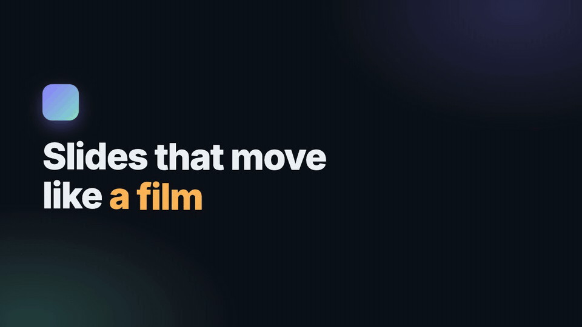
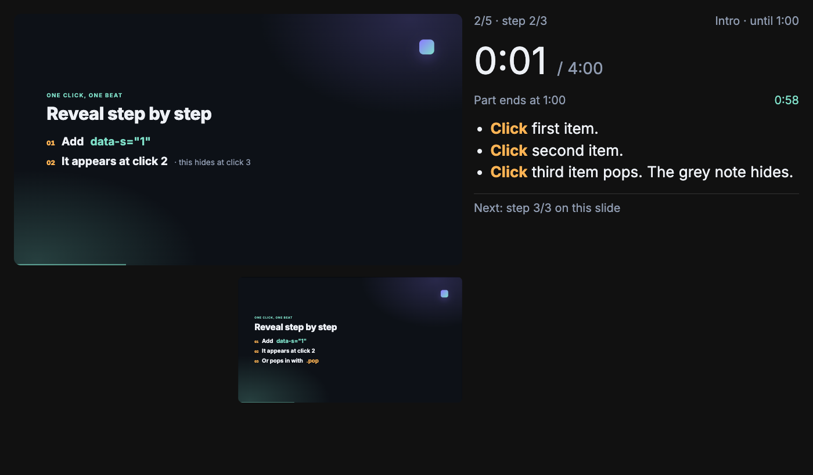

# lecternjs

Animated HTML slides that play like a film and advance like slides. A few static files, no build step, works offline.



## Why not PowerPoint or Google Slides

- **AI can edit it.** A slide is a `<section>` in one HTML file. Claude (or any AI) reads and edits all of it as plain text. Git diffs show what changed.
- **Motion past PowerPoint.** CSS and View Transitions: elements morph between slides, numbers roll, headings rise word by word, text types out.
- **Your own presenter window.** Notes, a timer per part of the talk, a preview of the next click, and speaker hand-overs. It is plain JS that you can change.
- **Offline from one folder.** Double-click `index.html`. No account, no internet.
- **Exports when you need it.** PDF or PPTX, one image per slide or per click.

Use PowerPoint if people who don't code need to co-edit the deck.

## Start

- **GitHub:** click *Use this template*, or run `gh repo create my-talk --template bestak/lecternjs --clone`.
  The copy includes files for this repo only. Delete them: `.claude-plugin/`, `skills/`, `.github/`, `scripts/record_gif.py`.
- **Claude Code:** `/plugin marketplace add bestak/lecternjs`, `/plugin install lectern@lecternjs`, then `/lectern:new`. Claude asks for the talk details and builds the skeleton.

## Present

Open `index.html` in Chrome.

| Key | Action |
|---|---|
| → ↓ PgDn Space Enter, click, clicker | Next step |
| ← ↑ PgUp | Back |
| P | Presenter window. Keys work in both windows. |
| F | Fullscreen |
| B or . | Black screen |
| R | Replay the slide: restart videos, rerun `data-enter` |
| T | Reset the timer |
| Home | First slide |

The mouse pointer is hidden on the main window. The timer starts at the first click. The URL hash (`#3.2`) keeps the slide and the step across reloads.



## Edit

All content is in `index.html`. Don't change `deck.js` unless you change the engine.

**Config** (`window.DECK` in `index.html`):

```js
window.DECK = {
  parts: { hook: { name: 'Hook', min: 1 }, demo: { name: 'Demo', min: 3 } }, // timer plan, in order
  speakers: { AB: 'Ada Byron' },           // optional, use with data-who
  labels: { next: 'Další', step: 'krok' }, // optional, presenter UI strings
}
```

`<html lang>` sets the number format of count-ups.

**Slide attributes:**

| Attribute | On | Effect |
|---|---|---|
| `class="slide"` | `<section>` | One slide. Add `center` to center it. |
| `data-part="hook"` | slide | Part for the timer and the background colours |
| `data-title="…"` | slide | Name in the presenter "Next" line |
| `data-who="AB"` | slide | Speaker. The presenter warns before a hand-over. |
| `data-steps="2"` | slide | Extra clicks with no element (for CSS `.s1`, `.s2` classes) |
| `data-enter="fn"` | slide | Calls `window.fn(slide)` when the slide opens |
| `data-s="1"` | element | Shows at click 1. `0` shows on entry. Add `pop` or `fade` for other entries. |
| `data-hide="2"` | element | Hides at click 2 |
| `data-count="1200"` | element | Rolls up to the number when shown |
| `data-type` / `data-type="40"` | element with `data-s` | Types its text when shown (ms per character) |
| `<aside class="notes">` | slide | Speaker notes. `<em>` highlights, `.cue` is a delivery hint. |
| `<video>` | slide | Plays on entry, pauses on exit. Muted in the presenter window. |

The slide gets class `s1`, `s2` … at each click. Use it in CSS for any custom step: `.slide.s2 .box{…}`.

Headings split into words and rise. An element with the same `view-transition-name` on two slides morphs between them (see `.mark` in the demo).

## Export

```sh
uv run scripts/export.py            # out/deck.pdf, out/deck.pptx, out/shots/*.png, one page per slide
uv run scripts/export.py --beats    # one page per click
```

The pages are images. Speaker notes go into the PPTX notes. Needs [uv](https://docs.astral.sh/uv/) and Chrome.

`uv run scripts/record_gif.py` records the README GIF and the presenter screenshot. Needs ffmpeg.

## Notes

Personal tool, shared as is. No support promised.

Claude Code contributed to this project.

Code: MIT. Inter font: SIL Open Font License (`assets/fonts/OFL.txt`).
